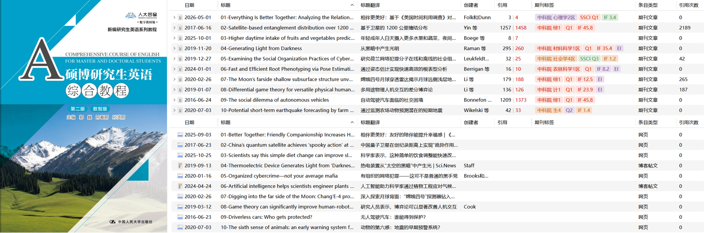
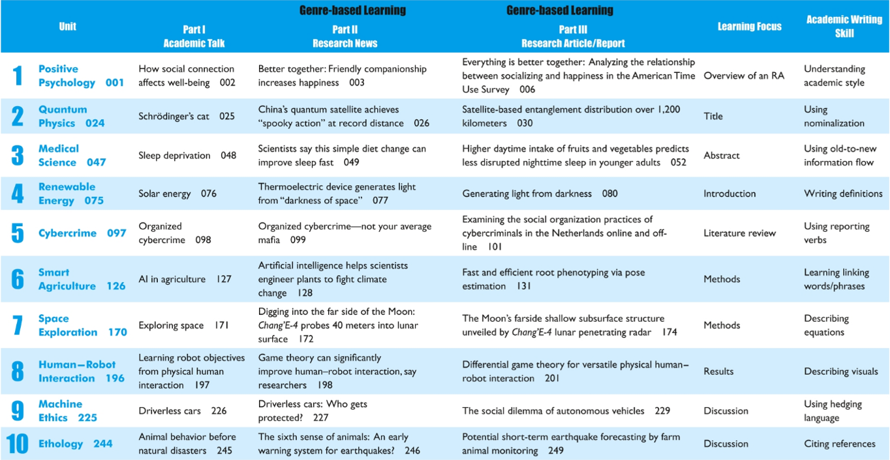
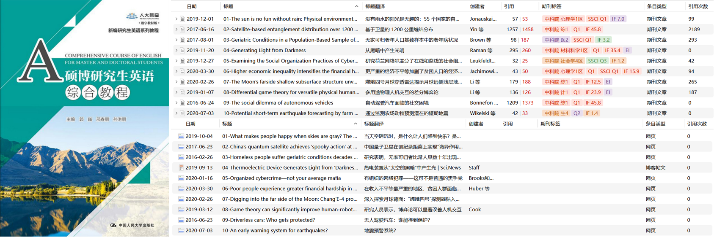
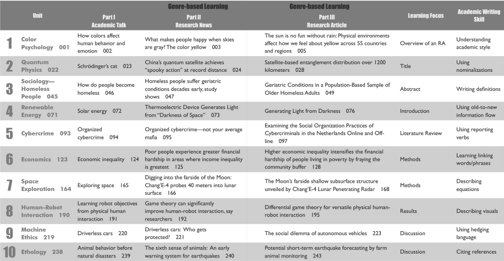
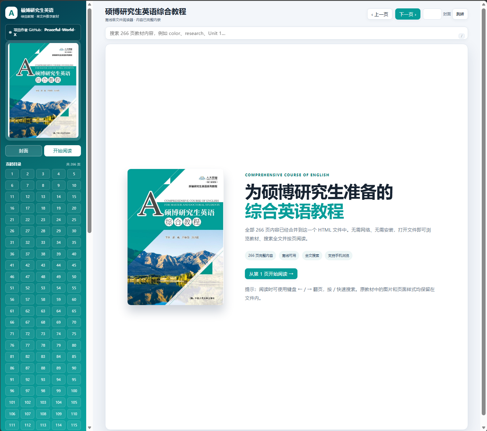
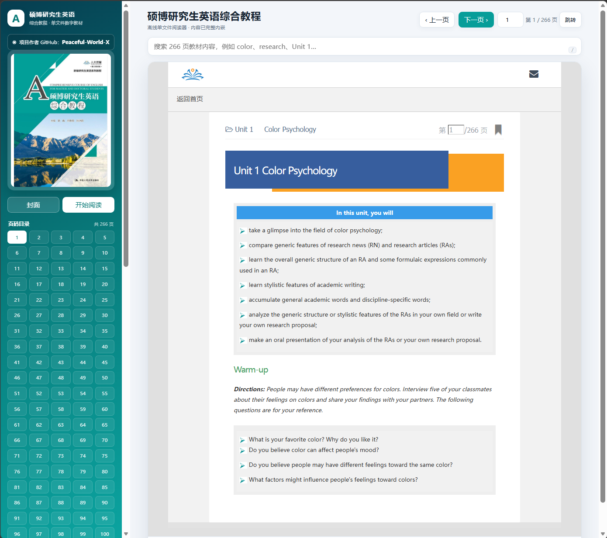

# 硕博研究生英语综合教程📚

**（如果对你有用，欢迎Star⭐~）** 

所有 PDF 和离线 HTML 文件统一放在 GitHub Releases，Zotero 组记录论文原稿和中英译文：

👉 [下载全部资料 - GitHub Releases](https://github.com/Peaceful-World-X/BUAA-English/releases)

👉 [加入Zotero组 - groups/5892796](https://www.zotero.org/groups/5892796)(一般当天就给通过了~)

### 📘 [第二版 Zotero 论文库](https://www.zotero.org/groups/5892796)

- **作者：** 郭巍、邢春丽、孙洪丽
- **ISBN：** 9787300353265

  

### 📗 [第一版 Zotero 论文库](https://www.zotero.org/groups/5892796)

- **作者：** 郭巍、邢春丽、孙洪丽
- **ISBN：** 9787300292540

  

## 📦 资料内容

🦜英语课使用的《硕博研究生英语综合教程》资料整理，包含教材、教师用书、课程课件，以及教材 RA（Research Article）对应的 SCI 论文原稿和中英译文。

- 📘 教材 PDF（OCR）
- 📝 教师用书 PDF（含答案）
- 🎓 课程思政教学大纲 PDF
- 🖥️ 教学课件 PDF
- 🌐 离线可复制 HTML 电子教材
- 🔬 教材 RA 文章对应的 SCI 论文原稿
- 🌏 论文中英译文（Zotero 整理）

## ⬇️ 下载

| 文件 | 说明 |
| --- | --- |
| `【教材】硕博研究生英语综合教程(OCR).pdf` | 01-Book_Student_OCR.pdf |
| `【教材】硕博研究生英语综合教程.html` | 离线可复制 HTML 教材，下载后直接打开 |
| `【答案】硕博研究生英语综合教程(教师用书) (OCR).pdf` | 03-Book_Teacher_OCR.pdf |
| `硕博研究生英语综合教程(课程思政教学大纲).pdf` | 04-Teaching_syllabus.pdf |
| `硕博研究生英语综合教程(教学课件).pdf` | 05-Teaching_courseware.pdf |

## 🔬 RA 论文整理

教材中的 RA 文章质量不错，我按课本内容逐篇整理了对应论文，并放入 Zotero 组，方便阅读、检索和管理：

👉 [加入 Zotero 组，获取论文原稿和中英译文](https://www.zotero.org/groups/5892796)

## 🖼️ 项目预览

  
  

## ✨ 使用方式

1. 从 [Releases](https://github.com/Peaceful-World-X/BUAA-English/releases) 下载需要的文件。
2. PDF 直接阅读；HTML 文件下载后用浏览器打开即可。
3. 论文原稿和中英译文可在 [Zotero 组](https://www.zotero.org/groups/5892796) 中查看。

🌱 欢迎补充勘误、译文或更好的论文整理方式！
